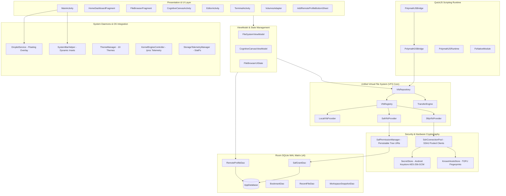

# Polymath Filesystem — Architecture End-Point & Codebase Blueprint
> **Version:** 2.1.0 (Hardened VFS, Cognitive Clips Droplet, Workbench, Intent Engine, Synapse P2P, Upgraded Viewers & Thumbnails)  
> **Target OS:** Android 16 (API 36) / Linux 5.15 aarch64 (Bionic libc)  
> **Build Engine:** AGY-NodeOS AST Graph & Jage Semantic Version Control (v53)  
> **Database:** Room SQLite WAL (Schema Version 7) + Android Keystore AES-256-GCM  

---

## 1. High-Level System Architecture



---

## 2. Comprehensive Subsystem & File Reference

### 2.1 Unified Virtual File System (VFS Core)
Location: `app/src/main/java/com/polymath/fs/domain/vfs/`

| File / Symbol | Lines & Types | Core Responsibilities & Invariants |
|---|---|---|
| [`VfsUri.kt`](file:///data/data/com.termux/files/home/Projects/polymath-filesystem/app/src/main/java/com/polymath/fs/domain/vfs/VfsUri.kt) | `class VfsUri` | Strongly typed URI parser supporting `file://`, `content://`, `sftp://`, `synapse://`. Automatically normalizes legacy paths into `file` scheme and encodes/decodes URI components. |
| [`VfsStat.kt`](file:///data/data/com.termux/files/home/Projects/polymath-filesystem/app/src/main/java/com/polymath/fs/domain/vfs/VfsStat.kt) | `data class VfsStat` | Immutable stat record: `uri`, `name`, `size`, `lastModified`, `isDirectory`, `isSymlink`, `mimeType`, `permissionsMode`. Replaces raw `File` instances across all providers. |
| [`VfsCapabilities.kt`](file:///data/data/com.termux/files/home/Projects/polymath-filesystem/app/src/main/java/com/polymath/fs/domain/vfs/VfsCapabilities.kt) | `data class VfsCapabilities` | Bitmask matrix defining provider capabilities: `canRead`, `canWrite`, `canDelete`, `canRename`, `canSeek`, `canWatch`, `canChmod`, `canChown`. |
| [`VfsProvider.kt`](file:///data/data/com.termux/files/home/Projects/polymath-filesystem/app/src/main/java/com/polymath/fs/domain/vfs/VfsProvider.kt) | `interface VfsProvider` | Universal backend contract: `list(uri)`, `stat(uri)`, `openRead(uri)`, `openWrite(uri, append)`, `delete(uri, recursive)`, `mkdir(uri)`, `rename(uri, newName)`, `chmod(uri, mode)`, `chown(uri, owner)`. |
| [`VfsRegistry.kt`](file:///data/data/com.termux/files/home/Projects/polymath-filesystem/app/src/main/java/com/polymath/fs/domain/vfs/VfsRegistry.kt) | `class VfsRegistry` | Thread-safe provider router. Routes `VfsUri` to matching registered provider by scheme with automatic `LocalVfsProvider` fallback. |
| [`TransferEngine.kt`](file:///data/data/com.termux/files/home/Projects/polymath-filesystem/app/src/main/java/com/polymath/fs/domain/vfs/TransferEngine.kt) | `class TransferEngine` | **Phase 5 Engine**: High-performance cross-provider streaming. Bounded 128 KiB chunk buffers (`128 * 1024` bytes), periodic `coroutineContext.ensureActive()` cancellation checks, 200ms throttled `Flow<Progress>` emissions, and recursive directory tree replication across heterogeneous schemes (`file` ↔ `content` ↔ `sftp`). |
| [`LocalVfsProvider.kt`](file:///data/data/com.termux/files/home/Projects/polymath-filesystem/app/src/main/java/com/polymath/fs/domain/vfs/provider/LocalVfsProvider.kt) | `class LocalVfsProvider` | Local filesystem implementation using `java.io.File` with seamless root shell fallback (`su -c`) when permission denied. Fast path `moveLocal()` preserves native atomic renames. |
| [`SafVfsProvider.kt`](file:///data/data/com.termux/files/home/Projects/polymath-filesystem/app/src/main/java/com/polymath/fs/domain/vfs/provider/SafVfsProvider.kt) | `class SafVfsProvider` | Storage Access Framework provider for SD cards and USB OTG trees (`content://`). Implements batch cursor projections (`buildChildDocumentsUriUsingTree`) to avoid N+1 IPC queries and supports automatic document creation fallback on write. |
| [`SftpVfsProvider.kt`](file:///data/data/com.termux/files/home/Projects/polymath-filesystem/app/src/main/java/com/polymath/fs/domain/vfs/provider/SftpVfsProvider.kt) | `class SftpVfsProvider` | Remote SFTP provider powered by SSHJ `0.38.0`. Bridges remote paths (`sftp://<host>/path`) to pooled `SFTPClient` sessions with stream wrappers (`RemoteFileInputStream`/`RemoteFileOutputStream`) and single-constructor JVM signature safety. |

---

### 2.2 Data Layer, Repositories & Room Database
Location: `app/src/main/java/com/polymath/fs/data/`

| File / Symbol | Location | Core Responsibilities & Invariants |
|---|---|---|
| [`AppDatabase.kt`](file:///data/data/com.termux/files/home/Projects/polymath-filesystem/app/src/main/java/com/polymath/fs/data/db/AppDatabase.kt) | `data/db/AppDatabase.kt` | Room Database (Version 7, SQLite WAL mode). Hosts `SafGrantDao`, `RemoteProfileDao`, `BookmarkDao`, `RecentFileDao`, `CognitiveCanvasDao`, `WorkspaceSnapshotDao`, and `CognitiveClipDao`. |
| [`IFileSystemRepository.kt`](file:///data/data/com.termux/files/home/Projects/polymath-filesystem/app/src/main/java/com/polymath/fs/data/repository/IFileSystemRepository.kt) | `data/repository/` | Interface preserving caller contracts for ViewModels and QuickJS bridge with additive VFS methods: `stat()`, `exists()`, `openRead()`, `openWrite()`. |
| [`VfsRepository.kt`](file:///data/data/com.termux/files/home/Projects/polymath-filesystem/app/src/main/java/com/polymath/fs/data/repository/VfsRepository.kt) | `data/repository/` | Primary production repository implementing `IFileSystemRepository`. Delegates operations to `VfsRegistry` and transfers to `TransferEngine`. |
| [`CognitiveClipEntity.kt`](file:///data/data/com.termux/files/home/Projects/polymath-filesystem/app/src/main/java/com/polymath/fs/data/db/entities/CognitiveClipEntity.kt) | `data/db/entities/` | Table `cognitive_clips`: stores captured clipboard history (`id`, `title`, `content`, `timestamp`, `isPinned`, `charCount`, `tags`) for research analysis. |
| [`CognitiveClipDao.kt`](file:///data/data/com.termux/files/home/Projects/polymath-filesystem/app/src/main/java/com/polymath/fs/data/db/dao/CognitiveClipDao.kt) | `data/db/dao/` | Reactive DAO exposing `Flow<List<CognitiveClipEntity>>`, keyword searching (`searchClips`), pinned/unpinned ordering, and clip modification/deletion. |
| [`SafGrantEntity.kt`](file:///data/data/com.termux/files/home/Projects/polymath-filesystem/app/src/main/java/com/polymath/fs/data/db/entities/SafGrantEntity.kt) | `data/db/entities/` | Table `saf_grants`: stores persistable tree URIs (`treeUriString`), user-friendly labels, writable status, and timestamps. |
| [`SafGrantDao.kt`](file:///data/data/com.termux/files/home/Projects/polymath-filesystem/app/src/main/java/com/polymath/fs/data/db/dao/SafGrantDao.kt) | `data/db/dao/` | Reactive DAO exposing `Flow<List<SafGrantEntity>>` for real-time drawer updates. |
| [`SafPermissionManager.kt`](file:///data/data/com.termux/files/home/Projects/polymath-filesystem/app/src/main/java/com/polymath/fs/data/saf/SafPermissionManager.kt) | `data/saf/` | Manages Android ContentResolver persistable URI permissions via `takePersistableUriPermission()` and `releasePersistableUriPermission()`. |
| [`RemoteProfileEntity.kt`](file:///data/data/com.termux/files/home/Projects/polymath-filesystem/app/src/main/java/com/polymath/fs/data/remote/RemoteProfileEntity.kt) | `data/remote/` | Table `remote_profiles`: stores host, port (default 22), username, authType (`PASSWORD` vs `PRIVATE_KEY`), `encryptedSecretRef`, and default remote path. |
| [`RemoteProfileDao.kt`](file:///data/data/com.termux/files/home/Projects/polymath-filesystem/app/src/main/java/com/polymath/fs/data/remote/RemoteProfileDao.kt) | `data/remote/` | Reactive DAO exposing `Flow<List<RemoteProfileEntity>>` and CRUD queries. |
| [`SecretStore.kt`](file:///data/data/com.termux/files/home/Projects/polymath-filesystem/app/src/main/java/com/polymath/fs/data/remote/SecretStore.kt) | `data/remote/` | Hardware-backed cryptographic store using `AndroidKeyStore` provider. Generates AES-256 keys and encrypts secrets with AES/GCM/NoPadding (128-bit authentication tag + 12-byte IV). |
| [`KnownHostsStore.kt`](file:///data/data/com.termux/files/home/Projects/polymath-filesystem/app/src/main/java/com/polymath/fs/data/remote/KnownHostsStore.kt) | `data/remote/` | Trust-On-First-Use (TOFU) host key verifier implementing SSHJ `HostKeyVerifier` via an explicit object to avoid Kotlin SAM constructor conflicts. |
| [`SshConnectionPool.kt`](file:///data/data/com.termux/files/home/Projects/polymath-filesystem/app/src/main/java/com/polymath/fs/data/remote/SshConnectionPool.kt) | `data/remote/` | Thread-safe connection pool with 30s keepalive, single-channel serialization mutexes, and auto-reconnect on socket drop. |

---

### 2.3 Presentation Layer, ViewModels & UI Components
Location: `app/src/main/java/com/polymath/fs/ui/` & `viewmodels/`

| File / Symbol | Location | Core Responsibilities & Invariants |
|---|---|---|
| [`MainActivity.kt`](file:///data/data/com.termux/files/home/Projects/polymath-filesystem/app/src/main/java/com/polymath/fs/MainActivity.kt) | `MainActivity.kt` | Host activity. Coordinates edge-to-edge system insets, elevated root crimson tinting, bottom navigation tab switching, `ActivityResultContracts.OpenDocumentTree` for SAF tree picking, and Zone A Volumes drawer navigation. |
| [`FileSystemViewModel.kt`](file:///data/data/com.termux/files/home/Projects/polymath-filesystem/app/src/main/java/com/polymath/fs/viewmodels/FileSystemViewModel.kt) | `viewmodels/` | Core VM. Exposes `uiState: StateFlow<FileBrowserUiState>`, `safGrants: StateFlow<List<SafGrantEntity>>`, `remoteProfiles: StateFlow<List<RemoteProfileEntity>>`, and `activeTransfer: StateFlow<ActiveTransfer?>`. Manages tabs, search filters, clipboard, and file operation dispatch with `cancelActiveTransfer()`. |
| [`VolumesAdapter.kt`](file:///data/data/com.termux/files/home/Projects/polymath-filesystem/app/src/main/java/com/polymath/fs/ui/volumes/VolumesAdapter.kt) | `ui/volumes/` | **Phase 4 Adapter**: Renders structured storage sections in Zone A drawer: Built-in Storage (`⚡ ROOT FS`, `📱 FLASH`), Granted SAF Trees (`📂 SAF TREE`), and Remote SFTP Profiles (`🔒 AES-256 • KEY`/`PWD`), with navigation, revocation, and deletion hooks. |
| [`AddRemoteProfileBottomSheet.kt`](file:///data/data/com.termux/files/home/Projects/polymath-filesystem/app/src/main/java/com/polymath/fs/ui/volumes/AddRemoteProfileBottomSheet.kt) | `ui/volumes/` | **Phase 4 BottomSheet**: Interactive Material 3 credential form for SFTP profiles (Host, Port, Username, Password vs Key file picker, Default Path) with AES-256 Android Keystore encryption & TOFU verification callout banner. |
| [`HomeDashboardFragment.kt`](file:///data/data/com.termux/files/home/Projects/polymath-filesystem/app/src/main/java/com/polymath/fs/ui/HomeDashboardFragment.kt) | `ui/` | Modular executive cockpit: live storage telemetry gauges, embedded physics Cognitive Canvas widget, QuickJS extensions carousel, active schedules, live `DropletService.isRunning` active/inactive pill badge, and `TransferEngine` real-time HUD with progress bar and cancellation. |
| [`FileBrowserFragment.kt`](file:///data/data/com.termux/files/home/Projects/polymath-filesystem/app/src/main/java/com/polymath/fs/ui/FileBrowserFragment.kt) | `ui/` | Primary browsing interface: multi-tab TabLayout, interactive clickable breadcrumb chips (`updateBreadcrumbChips`) for POSIX/SAF/SFTP, floating `TransferEngine` status dock (`cardTransferDock`), swipe-to-navigate-up gesture detector (`onFling`), contextual action mode (CAB), dual layout toggle (List/Grid), and OmniTerminal. Smart file routing dispatches images to `ImageViewerActivity`, markdown to `TextViewerActivity`, and code/scripts to `EditorActivity`. |
| [`FileListAdapter.kt`](file:///data/data/com.termux/files/home/Projects/polymath-filesystem/app/src/main/java/com/polymath/fs/ui/FileListAdapter.kt) | `ui/` | File list/grid adapter supporting POSIX octal permission badges (`tvPermissionsBadge`: `rwxr-xr-x`), distinct categorized file type tinting (code, audio, video, archives, apk, docs), and Coil thumbnail engine loading SAF `content://` URIs, local files, and real-time APK icon extraction via `PackageManager`. |
| [`DropletService.kt`](file:///data/data/com.termux/files/home/Projects/polymath-filesystem/app/src/main/java/com/polymath/fs/core/DropletService.kt) | `core/` | Hardened floating overlay clipboard service. Single-tap opens `CognitiveClipsActivity`; double-tap instantly captures system clipboard to Room DB (`CognitiveClipEntity`) with haptic pulse & HUD feedback; smooth drag updates overlay position. |
| [`CognitiveClipsActivity.kt`](file:///data/data/com.termux/files/home/Projects/polymath-filesystem/app/src/main/java/com/polymath/fs/ui/clips/CognitiveClipsActivity.kt) | `ui/clips/` | Cognitive Copied List for deep research. Live keyword search, edit dialog to modify captured titles/text, delete, pin to top, and export. **Tap-and-hold (long-press)** copies clip content directly back to the system clipboard for immediate pasting. |
| [`CognitiveClipAdapter.kt`](file:///data/data/com.termux/files/home/Projects/polymath-filesystem/app/src/main/java/com/polymath/fs/ui/clips/CognitiveClipAdapter.kt) | `ui/clips/` | RecyclerView adapter for cognitive clips displaying character count badges, formatted timestamps, pin states, edit/delete actions, and long-press copy listeners. |
| [`IntentEngineActivity.kt`](file:///data/data/com.termux/files/home/Projects/polymath-filesystem/app/src/main/java/com/polymath/fs/ui/intent/IntentEngineActivity.kt) | `ui/intent/` | Natural language semantic search console. Resolves time heuristics and query patterns via `IntentEngine`, scans VFS/filesystem, and displays results with informative reason badges ("Modified Today", "Keyword Match"). |
| [`SynapseActivity.kt`](file:///data/data/com.termux/files/home/Projects/polymath-filesystem/app/src/main/java/com/polymath/fs/ui/synapse/SynapseActivity.kt) | `ui/synapse/` | Synapse Protocol P2P Mesh console. Toggles port 8888 socket server, displays Wi-Fi IP, connects to remote peers, allows remote directory browsing & file downloading, and facilitates shared mesh clipboard broadcasts. |
| [`WorkbenchActivity.kt`](file:///data/data/com.termux/files/home/Projects/polymath-filesystem/app/src/main/java/com/polymath/fs/ui/workbench/WorkbenchActivity.kt) | `ui/workbench/` | Developer Cockpit & Codebase Telemetry inspector. Scans total lines, file counts, language breakdown meters (Kotlin, Java, XML, C/Rust, JS/TS, Python, Markdown), NodeOS/Jage status, and features a 16-byte hex inspector with magic header identification (ELF, DEX, APK, ZIP, PNG, JPEG, SQLite WAL). |
| [`TerminalActivity.kt`](file:///data/data/com.termux/files/home/Projects/polymath-filesystem/app/src/main/java/com/polymath/fs/ui/TerminalActivity.kt) | `ui/` | Native interactive shell console using `ProcessBuilder` (`/system/bin/sh` or `$PREFIX/bin/bash`). Real-time stdout/stderr streaming and quick action chips (`ls -la`, `pwd`, `df -h`, `uname -a`, `git status`, `nodeos -c ping`). |
| [`TextViewerActivity.kt`](file:///data/data/com.termux/files/home/Projects/polymath-filesystem/app/src/main/java/com/polymath/fs/viewers/TextViewerActivity.kt) | `viewers/` | Completely offline Markdown and text viewer with native formatting (headers, tables, code fences, blockquotes, lists) and "Edit in Editor" button directly launching `EditorActivity`. |
| [`ImageViewerActivity.kt`](file:///data/data/com.termux/files/home/Projects/polymath-filesystem/app/src/main/java/com/polymath/fs/viewers/ImageViewerActivity.kt) | `viewers/` | Modern Kotlin image viewer featuring pinch-to-zoom matrix transforms, double-tap zoom, sibling image gallery navigation, dimension/size display, and full SAF `content://` and local file support. |
| [`CognitiveCanvasActivity.kt`](file:///data/data/com.termux/files/home/Projects/polymath-filesystem/app/src/main/java/com/polymath/fs/ui/canvas/CognitiveCanvasActivity.kt) | `ui/canvas/` | Fullscreen 2D spatial file canvas with force-directed physics engine, heatmap overlays, ML cluster suggestions, preset layouts, and workspace snapshots. |
| [`EditorActivity.kt`](file:///data/data/com.termux/files/home/Projects/polymath-filesystem/app/src/main/java/com/polymath/fs/viewers/EditorActivity.kt) | `viewers/` | Code editor supporting syntax highlighting, line numbers, file encoding selection, and direct disk/VFS save. |
| [`SettingsActivity.kt`](file:///data/data/com.termux/files/home/Projects/polymath-filesystem/app/src/main/java/com/polymath/fs/ui/SettingsActivity.kt) | `ui/` | Theme studio (10 built-in themes), custom JSON theme importer, icon pack switcher, and root explorer permission toggles. |

---

### 2.4 QuickJS JavaScript Bridge & Extensibility
Location: `app/src/main/java/com/polymath/fs/js/`

| File / Symbol | Location | Core Responsibilities & Invariants |
|---|---|---|
| [`PolymathOSBridge.kt`](file:///data/data/com.termux/files/home/Projects/polymath-filesystem/app/src/main/java/com/polymath/fs/js/PolymathOSBridge.kt) | `js/` | **Phase 6 VFS Bridge**: Exposes `PolymathOSNativeInterface` to JavaScript runtime. `readFile`, `writeFile`, and `exists` dynamically dispatch across `content://`, `sftp://`, `synapse://`, and `file://` via `IFileSystemRepository` with zero crash risk. Replaced fake FTP/SMB stubs with structured reachability and VFS guidance. |
| [`PolymathJSBridge.kt`](file:///data/data/com.termux/files/home/Projects/polymath-filesystem/app/src/main/java/com/polymath/fs/js/PolymathJSBridge.kt) | `js/` | Bridges Android UI and Coroutine scopes to QuickJS runtime execution. Handles script alerts, console logs, and progress callbacks. |
| [`PolymathJSRuntime.kt`](file:///data/data/com.termux/files/home/Projects/polymath-filesystem/app/src/main/java/com/polymath/fs/js/runtime/PolymathJSRuntime.kt) | `js/runtime/` | Embeds the QuickJS C-engine runtime, managing memory heaps and lifecycle. |
| [`FsNativeModule.kt`](file:///data/data/com.termux/files/home/Projects/polymath-filesystem/app/src/main/java/com/polymath/fs/js/runtime/modules/FsNativeModule.kt) | `js/runtime/modules/` | Node.js-compatible `fs` module implementation in QuickJS (`fs.readFileSync`, `fs.writeFileSync`, `fs.existsSync`). |
| [`FtpClient.java`](file:///data/data/com.termux/files/home/Projects/polymath-filesystem/app/src/main/java/com/polymath/fs/network/FtpClient.java) | `network/` | `@Deprecated` legacy stub referencing `SftpVfsProvider` and the Unified VFS Provider architecture. |
| [`SmbClient.java`](file:///data/data/com.termux/files/home/Projects/polymath-filesystem/app/src/main/java/com/polymath/fs/network/SmbClient.java) | `network/` | `@Deprecated` legacy stub referencing `SftpVfsProvider` and the Unified VFS Provider architecture. |

---

### 2.5 Core System Daemons & Android OS Integration
Location: `app/src/main/java/com/polymath/fs/core/`

| File / Symbol | Location | Core Responsibilities & Invariants |
|---|---|---|
| [`DropletService.kt`](file:///data/data/com.termux/files/home/Projects/polymath-filesystem/app/src/main/java/com/polymath/fs/core/DropletService.kt) | `core/` | **Hardened Floating Service**: Floating overlay clipboard inbox. Inflates `layout_droplet.xml` using `ContextThemeWrapper(this, R.style.Theme_PolymathFileSystem)` to prevent MaterialCardView inflation crashes. Enforces WindowManager attachment safety and guards Android 10+ background clipboard restrictions. |
| [`SystemBarHelper.kt`](file:///data/data/com.termux/files/home/Projects/polymath-filesystem/app/src/main/java/com/polymath/fs/core/SystemBarHelper.kt) | `core/` | Manages edge-to-edge window insets. Automatically computes exact header surface luminance and toggles `WindowInsetsControllerCompat.isAppearanceLightStatusBars` so icons never disappear across light and dark themes. |
| [`ThemeManager.kt`](file:///data/data/com.termux/files/home/Projects/polymath-filesystem/app/src/main/java/com/polymath/fs/core/ThemeManager.kt) | `core/` | Coordinates 10 themes: Cyberpunk, Ocean Breeze, Dracula, Solarized Dark, Sunset, Hacker Green, Neon, Material You, iOS-like, True AMOLED, emitting `themeChangeEvents` to trigger smooth activity recreation. |
| [`KernelEngineController.kt`](file:///data/data/com.termux/files/home/Projects/polymath-filesystem/app/src/main/java/com/polymath/fs/core/KernelEngineController.kt) | `core/` | Parses `/proc/stat`, `/proc/loadavg`, `/proc/meminfo`, `/proc/cpuinfo`, and SELinux enforcement mode without requiring root privileges. |
| [`StorageTelemetryManager.kt`](file:///data/data/com.termux/files/home/Projects/polymath-filesystem/app/src/main/java/com/polymath/fs/core/StorageTelemetryManager.kt) | `core/` | Calculates partition capacities via `android.os.StatFs` for Primary Storage, Internal Flash, and Root System. |
| [`RootShellHolder.kt`](file:///data/data/com.termux/files/home/Projects/polymath-filesystem/app/src/main/java/com/polymath/fs/core/RootShellHolder.kt) | `core/` | Maintains persistent root shell process (`su`) with safe fallback and permission detection. |

---

## 3. NodeOS & Jage AST Version Control Topology

This workspace is dynamically tracked by **NodeOS** and **Jage**:

1. **Jage Semantic AST Version Control:**
   - Database: `.jsagent/history/ledger.json` & `.jsagent/schema/`
   - Push Command: `jage push` (generates content-addressable blobs and AST hashes).
   - AST Diff Analysis: `jage push --analyze` (computes semantic blast radius warnings).
   - Current Version: **v48** (Symbiotic Node Deduplicated).

2. **NodeOS Background Platform Linker:**
   - Database: `agy_nodeos.db` (SQLite WAL mode).
   - Dynamic CWD Binding: Rooted relative to `~/Projects/polymath-filesystem`.
   - Daemon Status: `nodeos -c ping` (expect `[Daemon Status] pong: OS Daemon is alive and running invisibly.`).
   - Querying the AST Graph:
     ```bash
     python3 -c "import sqlite3; c=sqlite3.connect('agy_nodeos.db').cursor(); c.execute('SELECT node_type, count(*) FROM nodes GROUP BY node_type;'); print(c.fetchall())"
     ```

---

## 4. Engineering Invariants & Micro-Refactoring Rules

When modifying or refining any single file in this codebase, adhere strictly to these invariants:

1. **Zero Mocking Invariant:**
   Never introduce simulated delays, fake return strings, or placeholder stubs. All operations must hit authentic endpoints, real Keystore ciphers, real Room DAOs, or real VFS streams.

2. **Stream Chunking & Memory Invariant:**
   All stream operations must use bounded 64–256 KiB buffers (standardized on 128 KiB via `TransferEngine.DEFAULT_BUFFER_SIZE`). Never call unbounded `readBytes()` on remote or SAF streams.

3. **Coroutine Cancellation Invariant:**
   All loops in `TransferEngine`, `VfsRepository`, or background workers must check `coroutineContext.ensureActive()` on every iteration to prevent unkillable background jobs.

4. **Progress Throttling Invariant:**
   Any `Flow<Progress>` emission must be throttled to a minimum interval of 200–250ms (plus initial 0% and terminal 100%) to preserve 60/120 FPS UI rendering.

5. **Theme Context Invariant:**
   Never inflate Material Components views (like `MaterialCardView`) inside a `Service` without wrapping the context in `ContextThemeWrapper(this, R.style.Theme_PolymathFileSystem)`.

6. **Offline QA Gate Invariant:**
   Always run the Universal QA Analyzer before committing:
   ```bash
   python ~/.gemini/config/skills/qa-analyzer/scripts/analyzer.py .
   ```
EOF
